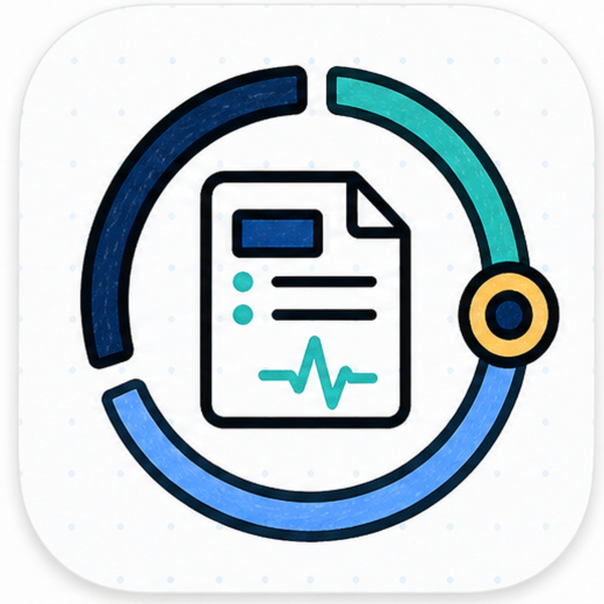
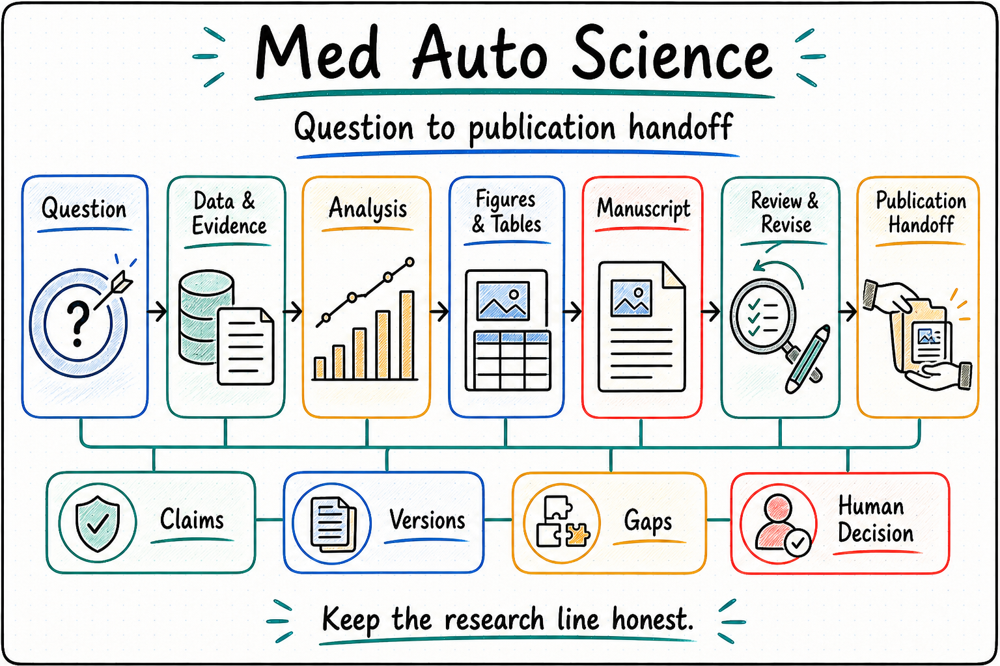

  

<strong>English</strong> | <a href="./README.zh-CN.md">中文</a>

<h1 align="center">Med Auto Science</h1>

Med Auto Science helps clinicians and medical research teams turn disease cohorts, clinical data, and preliminary findings into a study that colleagues can review against the evidence.

  

## Keep a study moving

If you have data and several possible topics, MAS helps compare the questions and identify the evidence each one needs. If you already have an analysis, it brings the results, figures, and drafts into the same study and identifies the next validation worth doing.

Return to the same study to add analyses, revise claims, or respond to reviewers. MAS connects each decision with the data and files behind it, and can draw on your team’s existing research notes. The study lead defines the clinical question, decides which conclusions to adopt, and chooses when to submit. At handoff, the manuscript, figures, supporting evidence, and remaining questions are ready to inspect together.

## Start with your study

> “Here is our disease cohort. Compare these two questions for clinical value and available evidence, and tell me which finding is worth validating next.”

> “Continue with the research direction we approved. Bring the additional analyses into the manuscript and figures, and give me a set of paper materials I can review.”

## Get started

Install **Med Auto Science** from the OPL Software Center. Create or open a study and tell MAS the disease area, the data you have, and what you want to accomplish this time. Researchers decide when to submit to a journal and supervise the submission. [Product boundaries](docs/architecture.md#产品与-workbench-边界) · [Current status](docs/status.md)

[MAS whitepaper](https://gaofeng21cn.github.io/one-person-lab/latest/whitepapers/mas-whitepaper.html) · [Documentation](docs/README.md) · [Architecture](docs/architecture.md)
