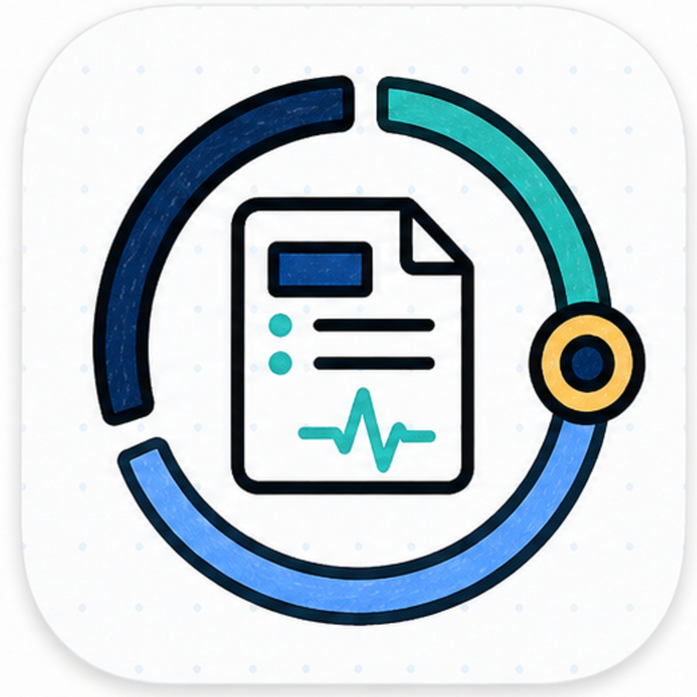
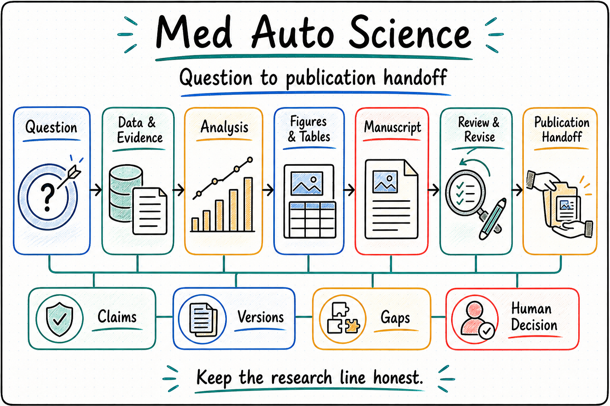

  

<a href="./README.md">English</a> | <strong>中文</strong>

<h1 align="center">Med Auto Science</h1>

Med Auto Science 帮医生和医学研究团队把手里的专病队列、临床数据和初步发现推进成一项有证据支撑、可以交给同行审阅的研究。

  

## 把课题持续推进下去

已有数据但题目还在比较时，MAS 帮你梳理几个可能的研究问题，判断各自需要哪些证据。已有分析时，它把结果、图表和草稿收在同一课题下，找出最值得补的验证，让后续写作沿着研究主线走。

你可以回到同一个课题继续补分析、改结论、吸收审稿意见。MAS 把每轮判断、所用数据和交付文件串起来，也可以引用团队原有的研究笔记。课题负责人确定临床问题、采用哪些结论和何时投稿。交审时，稿件、图表、支撑证据和待补项都有出处。

## 从你手里的课题开始

> “这是我们科的专病队列。帮我比较两个问题的临床价值和现有证据，告诉我下一步最值得验证什么。”

> “沿着已确认的研究主线继续。把补充分析放回稿件和图表，给我一版便于审阅的论文材料。”

## 开始使用

在 OPL 软件中心安装 **Med Auto Science**。新建或打开一个课题，告诉 MAS 病种、手头数据和这次希望推进到哪里。期刊投稿由研究者决定并监督。[产品入口](docs/product/README.md) · [当前状态](docs/status.md)

[MAS 白皮书](https://gaofeng21cn.github.io/one-person-lab/latest/whitepapers/mas-whitepaper.html) · [文档索引](docs/README.md) · [架构](docs/architecture.md)
